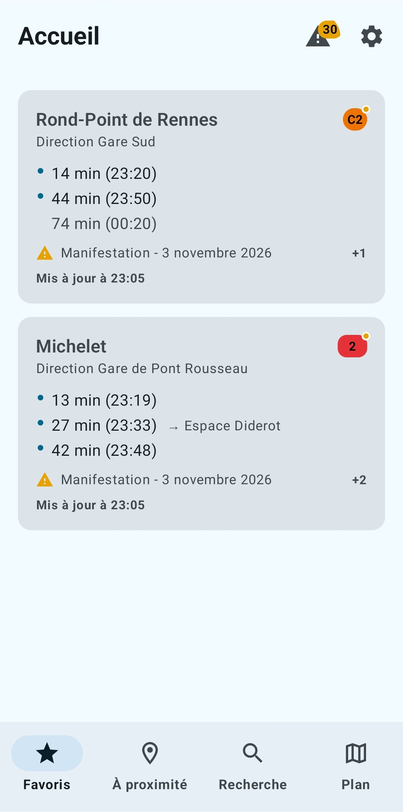
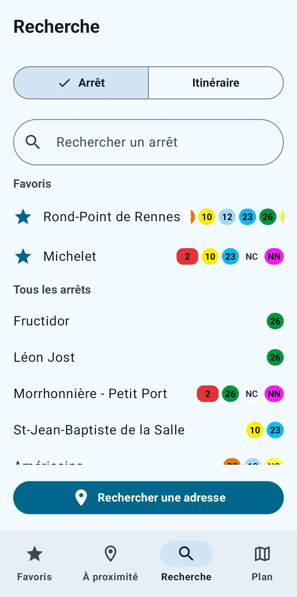
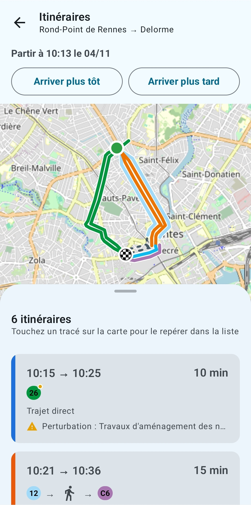
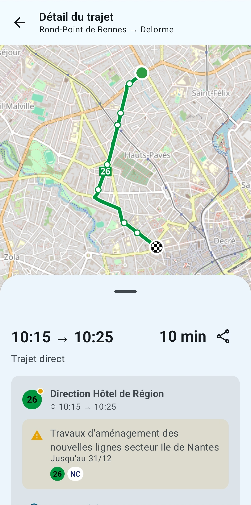

# Bus et Tram Nantes

A native Android alternative to the official Naolib app (Nantes public transport network), built
for speed, offline use and UX quality: favorites-driven live departures, unified stop / address /
itinerary search, itineraries shown on a map (street-accurate, options side by side), a full network
map, a home-screen widget and disruption notices. Built on **open
data**: the whole timetable (GTFS) ships with the app and refreshes itself daily, itineraries are
computed on the phone, and real-time departures come from the open Okina SIRI feed - everything
works offline except real time and address search.

- **Package name**: `com.bustramnantes.app`
- **Platform**: Android, native Kotlin, min SDK 26 (Android 8.0), target SDK 35
- **Architecture**: Clean Architecture (`data` / `domain` / `presentation`) + MVVM, Jetpack Compose,
  Hilt, Room, MapLibre
- **Language**: English in code, French in all UI strings

## Screenshots

<table>
  <tr>
    <td align="center"><br>Favorites</td>
    <td align="center"><br>Search</td>
    <td align="center"><br>Itineraries</td>
    <td align="center"><br>Journey detail</td>
  </tr>
</table>

## Data sources

| What | Source |
|---|---|
| Stops, lines, timetables, itineraries | Nantes Métropole open-data GTFS (Licence Ouverte), bundled as `assets/seed/network.bin` and refreshed on the device |
| Real-time departures | Okina SIRI StopMonitoring (keyless, 1 request / 30 s), GTFS-RT TripUpdates while a SIRI slot is pending |
| Disruption notices | Okina GTFS-RT Alerts (keyless, shares the GTFS-RT budget) |
| Bacs de Loire (B1, B2) | Département de Loire-Atlantique GTFS (Licence Ouverte), appended to the network |
| Walking paths in itineraries | OpenStreetMap pedestrian graph of Nantes Métropole (Geofabrik extract, ODbL), bundled as `assets/seed/walk_graph.bin` |
| Ride paths on itinerary maps | OpenStreetMap bus/tram ways and Naolib route relations (same extract, ODbL), one street path per stop-to-stop hop, stored in `network.bin` |
| Map line drawing / labels | Official Naolib map tiles (`plan-app.naolib.fr`, seeded offline) |
| Addresses | Géoplateforme (geopf.fr) |
| Basemap | OpenStreetMap |

`SOURCES.md` documents every source in detail (endpoints, ids, limits, measurements).

## Module layout

```
transit/                — pure-JVM core: GTFS converter, packed network format, RAPTOR router,
                          OSM walking graph, OSM ride paths, SIRI/GTFS-RT parsing, departure-board
                          composition (+ `packSeed` / `packWalkGraph` / `packRideShapes` tasks)
app/src/main/java/com/bustramnantes/app/
├── data/
│   ├── local/          — Room (favorites, recent searches) + AppPreferencesDataStore + seeded map tiles
│   ├── network/        — TransitNetworkRepository (seed / downloaded GTFS network), NetworkIndex
│   ├── realtime/       — RealtimeGateway (shared SIRI budget, boards per stop), disruptions
│   ├── remote/         — Okina client, open-data records API, Géoplateforme geocoding
│   └── repository/     — Repository implementations binding domain interfaces to data sources
├── domain/
│   ├── model/          — Stop, Line, Departure, Journey, Favorite, Disruption, …
│   ├── repository/     — Repository interfaces (the fixed data-layer contract)
│   ├── usecase/        — One class per action (favorites, search, itinerary, stop timetable)
│   └── util/           — Pure rules: phantom departures, disruption relevance, text matching, …
├── presentation/
│   ├── home/           — Home dashboard (favorites + live departures)
│   ├── search/         — Unified stop / address / itinerary search
│   ├── stop/           — Stop Detail bottom sheet
│   ├── timetable/      — Theoretical timetables
│   ├── map/            — Full-screen Naolib network map (MapLibre)
│   ├── nearby/         — Stops around the user
│   ├── itinerary/      — Itinerary results and step-by-step detail, both on a map; sharing
│   ├── disruptions/    — Network-wide disruption list
│   ├── settings/       — Theme / data / favorites / about
│   └── common/         — Theme, shared components, shared map view, navigation graph (`Screen`, `AppNavGraph`)
├── widget/             — Glance home-screen widget + its configuration Activity
├── worker/             — WorkManager background tasks (daily network refresh, widget refresh)
├── BusEtTramApplication.kt — Hilt root; schedules background work, MapLibre setup
└── MainActivity.kt         — Single-activity host; resolves launch tab, hosts theme/nav/bottom bar
```

## Building

```bash
./gradlew :app:assembleDebug                     # -> app/build/outputs/apk/debug/app-<abi>-debug.apk (+ universal)
./gradlew :transit:test :app:testDebugUnitTest   # JVM unit tests
./gradlew :transit:packSeed [-Pgtfs=/path.zip]   # regenerate assets/seed/network.bin
./gradlew :transit:packWalkGraph -Posm=/path/pays-de-la-loire-YYMMDD.osm.pbf  # regenerate walk_graph.bin
./gradlew :transit:packRideShapes -Posm=/path/pays-de-la-loire-YYMMDD.osm.pbf # add OSM ride paths to network.bin
```

No API keys or `local.properties` secrets are required beyond `sdk.dir`: every network call is to a
public, keyless endpoint.

Live, opt-in tests hit the real services:
`LIVE_API=1 ./gradlew --no-daemon :app:testDebugUnitTest --tests '*Live*' --rerun`.

## Releasing (GitHub + F-Droid)

The release build is unsigned and reproducible: F-Droid rebuilds each tag, checks that its build is
byte-identical to the APK attached to the GitHub release and publishes that APK, signed with our key
(the fdroiddata recipe, `metadata/com.bustramnantes.app.yml` in fdroiddata, is kept outside this
repository).

**One APK per ABI.** The map engine's native code (`libmaplibre.so`, 8-11 MB per ABI, stored
uncompressed) is most of the APK, so the release build makes one APK per ABI plus a universal one:

| APK | For | versionCode | Size |
|---|---|---|---|
| `app-arm64-v8a-release.apk` | nearly every phone (64-bit ARM) | `versionCode * 10 + 3` | ~21 MB |
| `app-armeabi-v7a-release.apk` | older 32-bit phones | `versionCode * 10 + 1` | ~18 MB |
| `app-x86_64-release.apk` | emulators, Chromebooks | `versionCode * 10 + 4` | ~22 MB |
| `app-universal-release.apk` | anyone unsure (GitHub only) | `versionCode * 10` | ~41 MB |

x86 (32-bit) is not shipped. F-Droid has one build block per ABI (`gradleprops: targetAbi=<abi>`,
which builds that ABI alone - byte-identical to the split build's APK) and installs the highest
versionCode a device accepts, hence arm64-v8a > armeabi-v7a. The digits are `ABI_DIGITS` in
`app/build.gradle.kts` and `VercodeOperation` in the recipe: change both together.

1. Bump `versionCode` and `versionName` in `app/build.gradle.kts`, add the changelog as
   `fastlane/metadata/android/{en-US,fr-FR}/changelogs/<versionCode * 10 + n>.txt` for n = 1, 3
   and 4 (the same text three times: F-Droid matches a changelog to each APK by its own
   versionCode; the workflow checks they exist and match), commit.
2. Tag `v<versionName>` and push the commit and the tag.
3. `.github/workflows/release.yml` runs the tests, builds and signs the four APKs
   (`fdroid/sign-release.sh`, key from the repository secrets) and publishes the GitHub release
   with them and the changelog. F-Droid picks the tag up on its own.
   Its actions are pinned to commit SHAs with [ratchet](https://github.com/sethvargo/ratchet)
   (`ratchet lint` / `ratchet upgrade .github/workflows/release.yml`; the binary is not committed).

By hand instead: `KEYSTORE=/path/release.jks KEY_ALIAS=release fdroid/sign-release.sh`, then attach
the four `app/build/outputs/apk/release/app-*-release.apk` it lists to the release under those
exact names (each F-Droid build block's `binary:` points at one).

## Not built (yet)

- Live vehicle positions: the upstream feeds (GTFS-RT VehiclePositions, SIRI VM) are empty.
- Departure alerts / notifications, a map line-filter panel.
